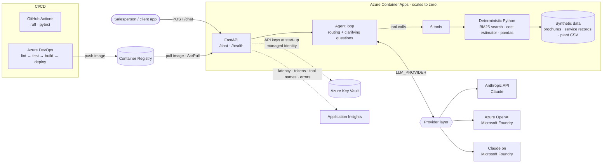

# Norvale Sales Assistant

[](https://github.com/affira/water-sales-assistant/actions/workflows/ci.yml)

An AI sales assistant for a water-treatment equipment company, built in Python. A salesperson on a customer call can ask it to recommend a product, estimate the cost of a field service visit, or judge whether a customer's plant readings are normal. For each message, an LLM agent decides which of its six tools to call, or whether to ask a clarifying question. Every number in the answer is computed by deterministic Python and cites its source (brochure page or service report ID). The agent runs on **Claude (Anthropic API), Azure OpenAI or Claude on Microsoft Foundry**, selected by one setting. It ships as a FastAPI service in Docker, deployed to **Azure Container Apps** with Terraform. API keys come from **Key Vault** via managed identity, monitoring goes to **Application Insights**, and CI/CD runs on GitHub Actions and Azure DevOps.

> **All data in this repository is synthetic.** Norvale Water Technologies, its products, customers, technicians,
> service reports and plant data are fictional, generated by [`scripts/generate_data.py`](scripts/generate_data.py).
> The data is deliberately messy so the system has real problems to handle: nine currencies, missing costs,
> truncated tables, VAT, weekend rates, ambiguous dates, a copy-paste error, and two brochure editions that
> contradict each other. It is not affiliated with any real company.

> 📸 **Screenshot placeholder:** `docs/screenshots/cli-trace.png` (the CLI with `--trace` answering the Chile cost question, showing tool calls)

## What it does

| Ask | Example | What happens |
|---|---|---|
| Product recommendation | *"We have ClarionRO units but permeate quality drops when the feed water changes."* | Searches 11 brochures. Recommends AquaTune Optimizer (plus UltraGuard UF if turbidity is the cause) and cites the pages. |
| Service cost estimate | *"12 membrane elements on a ClarionRO-500 in Chile. What should I budget?"* | Estimates **USD 8,200–10,800** from 50 past reports, citing them. Flags that there's no Chile history for this job, and asks where the site is. |
| Process assessment | *"62 µS/cm permeate at 72% recovery, feed 2,400 µS/cm. Normal?"* | Compares with 4,300+ hours of plant data: worse than ~94% of all hours, and than almost every comparable one. Suggests causes and says how far to trust the comparison. |

It says "I don't know" when the data doesn't cover a question. For example, the brochures contain no prices, and it won't invent a spec.

## Architecture



| Layer | Code |
|---|---|
| HTTP API, sessions, cited-source checks | [`api.py`](aquaassist/api.py), [`sessions.py`](aquaassist/sessions.py), [`citations.py`](aquaassist/citations.py) |
| Agent loop and system prompt | [`agent.py`](aquaassist/agent.py) |
| Tool schemas (the routing surface) | [`tools.py`](aquaassist/tools.py) |
| Deterministic engines | [`retrieval.py`](aquaassist/retrieval.py) (BM25), [`cost.py`](aquaassist/cost.py), [`process.py`](aquaassist/process.py) |
| LLM provider layer | [`providers/`](aquaassist/providers): internal format, one format converter, three backends |
| Report extraction (offline) | [`extraction.py`](aquaassist/extraction.py): LLM reads, Python validates |
| Secrets and monitoring | [`secret_store.py`](aquaassist/secret_store.py), [`telemetry.py`](aquaassist/telemetry.py), [`runtime.py`](aquaassist/runtime.py) |
| Infrastructure and pipelines | [`infra/`](infra) (Terraform), [`azure-pipelines.yml`](azure-pipelines.yml), [`.github/workflows/ci.yml`](.github/workflows/ci.yml) |

## Design decisions

### Numbers stay in Python, not in the LLM
The LLM **routes and explains**; deterministic code **computes**.
- The cost estimator assembles each estimate from evidence: on-site hours from a linear fit on job size, local labour and travel rates, and part prices from comparable reports.
- The process analysis uses pandas percentiles on cleaned data.
- The model only chooses tools and writes the answer around their results.

Why this matters:
- **No invented numbers:** every figure traces back to report IDs or brochure pages.
- **Reproducible and testable:** the same input always gives the same estimate, so the logic is unit-tested.
- **Auditable:** each estimate lists its components, the reports used and caveats such as "no history in this country".

The LLM is still used where language understanding matters: reading 50 messy technician reports into a strict JSON schema. Python then checks that output (line arithmetic, totals vs. VAT, copy-paste errors). The answer also says which citations are **verified**: a cited source is marked `verified: true` only if a tool actually returned it during that turn.

### A provider switch
`LLM_PROVIDER` selects `anthropic`, `azure_openai` or `foundry_claude`.
- **Internal format:** the agent works on one provider-neutral message and tool-call format.
- **One converter:** [`providers/convert.py`](aquaassist/providers/convert.py) is the only place that translates between Anthropic tool use and OpenAI function calling.

Why this matters:
- **Avoid lock-in, and compare models and costs** without touching the agent, the tools or the maths.
- **Run on the infrastructure available.** This project was developed and demonstrated on Azure OpenAI (`gpt-5-mini`) using Azure student credit.
- **Test everything per provider.** Fake SDK clients return each SDK's real response shapes, so the agent loop and API are tested on all three backends offline.

### Secrets: Key Vault and managed identity
- **No keys in code, images, Terraform or pipelines.**
- **On Azure,** the container app has a user-assigned managed identity with *Key Vault Secrets User*. At start-up it reads its API keys from Key Vault using `DefaultAzureCredential`.
- **Locally,** the same code uses your `az login`, or falls back to environment variables.
- **Logging:** only variable names and their source are logged, never values.

### Monitoring: OpenTelemetry to Application Insights
- **Recorded:** per request, the latency, outcome and **names** of the tools used. Per LLM call, the latency and **input/output token counts**. Plus error codes.
- **Never recorded:** message or reply text, tool inputs, session IDs or exception messages.
- **Tested:** a privacy test sends a message containing a name and phone number and checks that none of it reaches any exported span or metric.

### Smaller decisions
- **Retrieval:** BM25 keyword search instead of embeddings. It's accurate for 11 short brochures, free and explainable. It sits behind one `search()` interface, so it can be swapped for hybrid vector search at scale.
- **Hand-written agent loop** instead of a framework. Every step is visible and testable.
- **Sessions:** kept in memory with one replica. A shared store (Redis or Cosmos DB) would be needed to scale out.

## Results (synthetic data)

**Report extraction.** `gpt-5-mini` on Azure OpenAI, scored against the generator's ground truth with [`eval/eval_extraction.py`](eval/eval_extraction.py):

| Field | Score |
|---|---|
| Hours, rates, totals, cost status, weekend and customer-parts flags | 50/50 |
| Country (after deterministic harmonisation) | 50/50 |
| Currency, where a cost is stated | 34/34 |
| Main quantity | 48/50 |
| Task type (2 of 3 misses aren't knowable from "standard maintenance" notes) | 47/50 |

**Tests:** 133 offline tests, run on every push. LLM calls use fake SDK clients, and all network access is blocked during tests.

> 📸 **Screenshot placeholder:** `docs/screenshots/github-actions.png` (passing GitHub Actions run)

## Run it locally

Requires Python 3.9+ (3.12 recommended) and one LLM backend: an Anthropic API key, or an Azure OpenAI deployment.

```bash
git clone https://github.com/affira/water-sales-assistant.git
cd water-sales-assistant
python3 -m venv .venv && source .venv/bin/activate
pip install -r requirements-dev.txt

cp .env.example .env            # fill in ONE backend (see Environment variables); .env is gitignored
set -a; source .env; set +a     # load it into this terminal
```

The extracted service records ([`index/service_records.json`](index/service_records.json)) are committed, so ingest is only needed if you change the reports: `python -m aquaassist.ingest`.

### CLI
```bash
python -m aquaassist.cli --trace     # interactive chat; --trace shows tool calls
python -m aquaassist.cli --once "What is the maximum feed TDS for a ClarionRO system?"
```

### HTTP API
```bash
uvicorn aquaassist.api:app --port 8000          # interactive docs: http://localhost:8000/docs

curl http://localhost:8000/health
curl -X POST http://localhost:8000/chat -H "Content-Type: application/json" \
  -d '{"session_id": "demo", "message": "A customer in Chile needs 12 membrane elements replaced on a ClarionRO-500. What should I budget?"}'
```

`POST /chat` returns `{session_id, reply, sources, tools_used}`.
- **Sources:** each has `verified: true` only if a tool returned it during that turn.
- **Sessions:** reuse the same `session_id` to continue a conversation, e.g. answer the clarifying question: `"Antofagasta, about 9 hours round trip."`
- **Errors:** invalid input returns 422 with field-level details. LLM failures return 429, 502 or 503 without echoing upstream error text.

> 📸 **Screenshot placeholder:** `docs/screenshots/api-docs.png` (Swagger UI at `/docs` with a `/chat` response showing verified sources)

### Docker
```bash
docker build -t water-sales-assistant .
docker run --rm -p 8000:8000 --env-file .env water-sales-assistant
curl http://localhost:8000/health
```
The image (`python:3.12-slim`) runs as a non-root user and contains no secrets; all settings come from `--env-file` or `-e`. On Apple-silicon Macs, add `--platform linux/amd64` when building for Azure.

### Tests, lint and evaluation
```bash
pytest -q                          # 133 offline tests (no API key, no network)
ruff check .                       # lint, version pinned in requirements-dev.txt
python eval/eval_extraction.py     # extraction accuracy vs. ground truth
```
More demo prompts with the expected behaviour: [`eval/demo_prompts.md`](eval/demo_prompts.md).

## Environment variables

All of these are listed with placeholder values in [`.env.example`](.env.example). A test fails if the code reads a variable that isn't documented there.

| Variable | Needed for | Default | Purpose |
|---|---|---|---|
| `LLM_PROVIDER` | all | `anthropic` | `anthropic`, `azure_openai` or `foundry_claude` |
| `ANTHROPIC_API_KEY` | `anthropic` | none | Anthropic API key (or Key Vault secret `anthropic-api-key`) |
| `AQUAASSIST_MODEL` | `anthropic` | `claude-opus-5-5` | Claude model |
| `AQUAASSIST_EFFORT` | Claude backends | `medium` | Reasoning effort for agent turns |
| `AQUAASSIST_EXTRACTION_EFFORT` | Claude backends | `low` | Reasoning effort for report extraction |
| `AZURE_OPENAI_ENDPOINT` | `azure_openai` | none | `https://<resource>.openai.azure.com` |
| `AZURE_OPENAI_DEPLOYMENT` | `azure_openai` | none | Deployment name, e.g. `gpt-5-mini` |
| `AZURE_OPENAI_API_KEY` | `azure_openai` | none | Key (or Key Vault secret `azure-openai-api-key`) |
| `AZURE_OPENAI_API_VERSION` | `azure_openai` | `v1` | `v1` uses the recommended `OpenAI()` client; a dated version uses `AzureOpenAI()` |
| `ANTHROPIC_FOUNDRY_BASE_URL` | `foundry_claude` | none | `https://<resource>.services.ai.azure.com/anthropic` |
| `ANTHROPIC_FOUNDRY_API_KEY` | `foundry_claude` | none | Key (or Key Vault secret `anthropic-foundry-api-key`) |
| `FOUNDRY_CLAUDE_DEPLOYMENT` | `foundry_claude` | `claude-opus-5-5` | Claude deployment name in Foundry |
| `KEY_VAULT_URL` | optional | empty = off | Read the API keys above from this Key Vault |
| `APPLICATIONINSIGHTS_CONNECTION_STRING` | optional | empty = off | Export monitoring to Application Insights |
| `AZURE_CLIENT_ID` | on Azure | set by Terraform | Which managed identity `DefaultAzureCredential` uses |

## Deploy to Azure

Terraform in [`infra/`](infra) creates:
- a resource group
- Log Analytics and Application Insights
- a Basic container registry
- a Key Vault
- a managed identity with *AcrPull* and *Key Vault Secrets User*
- a Container Apps environment and app (0.25 vCPU / 0.5 GiB, scale to zero)

The default region is `norwayeast`; Azure for Students only allows certain regions. The Azure OpenAI resource is referenced by endpoint, not created by Terraform.

Prerequisites:
- Terraform 1.6+
- Azure CLI, signed in with `az login`
- Docker
- an Azure OpenAI deployment

```bash
cd infra
export ARM_SUBSCRIPTION_ID="$(az account show --query id -o tsv)"
cp terraform.tfvars.example terraform.tfvars      # set azure_openai_endpoint

# 1) Infrastructure (the app starts with a public placeholder image)
terraform init
terraform plan -out tfplan
terraform apply tfplan

# 2) API key into Key Vault, read from your .env and never typed
#    (if "Forbidden": your new role is still propagating, retry after a minute)
set -a; source ../.env; set +a
az keyvault secret set --vault-name "$(terraform output -raw key_vault_name)" \
  --name azure-openai-api-key --value "$AZURE_OPENAI_API_KEY" --output none

# 3) Build for linux/amd64 and push
ACR_SERVER="$(terraform output -raw registry_login_server)"
az acr login --name "$(terraform output -raw registry_name)"
docker build --platform linux/amd64 -t "$ACR_SERVER/water-sales-assistant:v1" ..
docker push "$ACR_SERVER/water-sales-assistant:v1"

# 4) Switch the app to the real image, then check it (first call after idle takes ~10-20 s)
terraform apply -var container_image=water-sales-assistant:v1
curl "$(terraform output -raw app_url)/health"
```

> 📸 **Screenshot placeholder:** `docs/screenshots/azure-container-app.png` (Container App overview in the Azure portal)
>
> 📸 **Screenshot placeholder:** `docs/screenshots/app-insights.png` (Application Insights: request latency and `aquaassist.llm.tokens`)

### CI/CD
- **GitHub Actions** ([`ci.yml`](.github/workflows/ci.yml)): `ruff` and `pytest` on every push and pull request. No secrets involved.
- **Azure DevOps** ([`azure-pipelines.yml`](azure-pipelines.yml)): Lint → Test → Build & push image (tagged with the build ID) → Deploy to the container app with a `/health` check.
  - Build and Deploy run only for pushes to `main`.
  - **Setup:** an Azure Resource Manager service connection (named in the `azureServiceConnection` variable; Contributor on the resource group), plus the pipeline variables `acrName`, `resourceGroupName` and `containerAppName` from `terraform output`.
  - **After a pipeline deploy,** set Terraform's `container_image` to the deployed tag before the next `terraform apply`. See [`infra/README.md`](infra/README.md).

> 📸 **Screenshot placeholder:** `docs/screenshots/azure-devops-pipeline.png` (pipeline run with the four stages)

## Cost

Rough list prices; check the Azure pricing calculator for your region.

| Resource | Monthly cost |
|---|---|
| Container Registry, Basic | **about $5**, the only fixed cost |
| Container app (scale to zero) | **$0 when idle.** About 200 active hours a month are free at this size, then about $0.03 per active hour |
| Container Apps environment, managed identity, role assignments | free |
| Key Vault | cents (3 secret reads per cold start) |
| Log Analytics + Application Insights | $0: log ingestion is capped at 0.1 GB/day, inside the 5 GB/month free allowance |
| Azure OpenAI `gpt-5-mini` | per token; fractions of a cent per chat message, a few cents to extract all 50 reports |

**Expected total: about $5 a month.** Set an Azure budget alert anyway.

## Tear it down

```bash
cd infra
export ARM_SUBSCRIPTION_ID="$(az account show --query id -o tsv)"
terraform destroy -var container_image=water-sales-assistant:v1
```

This deletes everything Terraform created, including the images in the registry, and purges the Key Vault. The Azure OpenAI resource was created separately; to remove it as well:

```bash
az cognitiveservices account delete --resource-group <its-resource-group> --name <your-foundry-resource>
az cognitiveservices account purge --resource-group <its-resource-group> --name <your-foundry-resource> --location <its-region>
```

## Limitations and next steps
- **The deployed API has no authentication.** The Container App ingress is public, so anyone with the URL can call `/chat` and use model credit. Before sharing the URL, add Container Apps authentication (Microsoft Entra ID), an API key check, or IP restrictions.
- **Sessions are in memory,** with one replica. Scaling out needs a shared session store.
- **Cost estimates are planning figures.** FX rates are fixed assumptions, and sparse history gives wide ranges.
- **The process comparison uses one reference plant.** It shows correlation, not cause.
- **Possible next steps:** hybrid vector search for larger document sets, an evaluation set for whole agent answers (not just extraction), and Entra ID authentication on the API.

## Project layout

```
aquaassist/          application code
  api.py             FastAPI service: /chat, /health
  agent.py           system prompt + tool-use loop
  tools.py           tool schemas + dispatcher
  providers/         LLM backends: base.py (internal format), convert.py (format translation),
                     anthropic_api.py (Anthropic API + Foundry Claude), azure_openai.py
  retrieval.py       brochure chunking + BM25
  cost.py            service cost estimator
  process.py         RO process data analysis
  extraction.py      report -> JSON (LLM) + validation rules (Python)
  countries.py       deterministic country-name harmonisation
  citations.py       extract and verify cited sources
  sessions.py        in-memory per-session agents
  secret_store.py    Key Vault secrets
  telemetry.py       OpenTelemetry / Azure Monitor
  runtime.py         start-up: secrets, then monitoring
  cli.py, ingest.py, config.py
data/                synthetic brochures, service reports, hourly plant CSV
index/               extracted service records (committed)
scripts/             synthetic data generator
eval/                ground truth, extraction eval, demo prompts
tests/               133 offline tests (fake LLM clients, no network)
infra/               Terraform for Azure; see infra/README.md
docs/screenshots/    screenshots for this README
```
